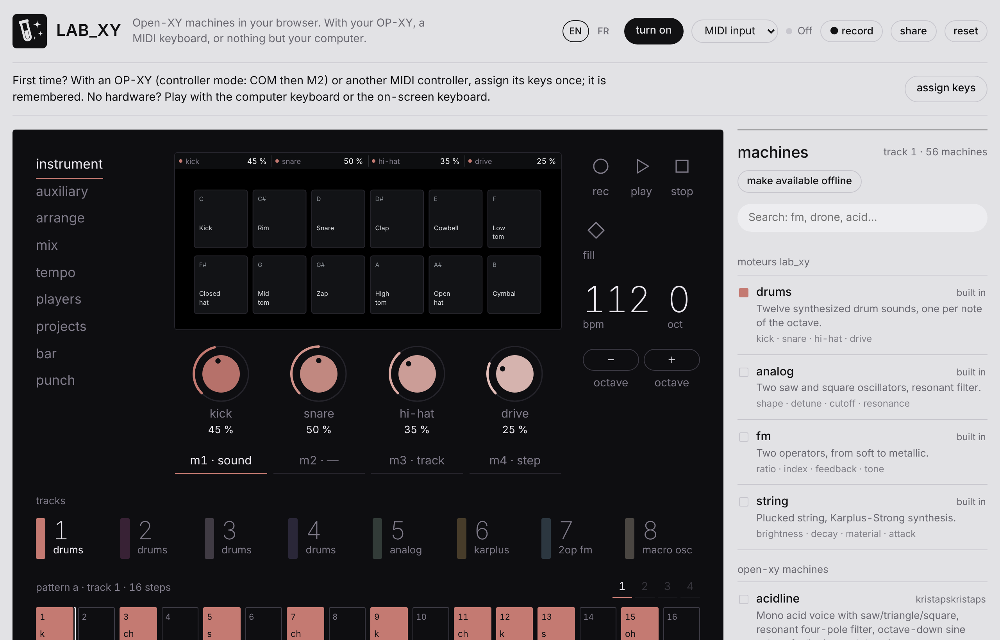

# LAB_XY

**Play Open-XY machines in your browser — no need to flash your OP-XY.**

👉 **[lab-xy.netlify.app](https://lab-xy.netlify.app)** · 🐞 [Report a bug or suggest an idea](https://github.com/Choom-engineering/Lab-Xy/issues) · 🇫🇷 [Version française](README.fr.md)

LAB_XY is a web groovebox built around the community machines of [Open-XY](https://github.com/etcetc000/open-xy). Try them with your OP-XY as a USB MIDI controller, with any MIDI keyboard, or with no hardware at all.

> **Beta.** Machines run from the same code as on the device, but sound and behaviour can differ slightly from a real OP-XY. Feedback is very welcome.

## Features

- **69 sounds**: 56 Open-XY community synths, 5 Open-XY drum kits, four LAB_XY machines (Champagne; Babel, a speaking machine; Flux, stereo additive resynthesis with FM; Neon Rain, swelling brass and choir through a stereo ensemble) and four built-in engines (drums, analog, FM, string)
- **Random** steps and sound **scramble** on any track, with undo
- **8 tracks** and a **64-step sequencer** with p-locks, chords per step, trig conditions, Fill and latch
- **Arrange**: 16 patterns (A to P) chained into a song
- **Punch-in effects** with their own visuals: repeat, roll, reverse, tape stop, filters, bits, gate
- **Players**: arpeggiator and chords
- **WAV recording** and **share links** that hold the whole project
- **Installable** as an app, works **offline**
- English and French interface

## Getting started

1. Open **[lab-xy.netlify.app](https://lab-xy.netlify.app)** in **Chrome** or **Edge**. Web MIDI is not available in Safari.
2. Click **turn on** and allow MIDI access when the browser asks.
3. Play:
   - **OP-XY**: plug it in over USB and put it in controller mode (COM, then M2). Click **assign keys** once to map its keys; the mapping is remembered.
   - **Another MIDI controller**: same thing, notes work straight away.
   - **No hardware**: computer keyboard (A to K for notes, Z / X for octave, Space for play / stop) or the on-screen keys.

To install it, use **Install the app** at the top of the page. To play offline, click **make available offline** in the Machines panel.

## Reporting a bug

Open an [issue](https://github.com/Choom-engineering/Lab-Xy/issues) and include:

- your browser and system, and the controller you use (OP-XY, other, none);
- the machine and what you did just before the problem;
- for encoder problems: the diagnostic line shown under **MIDI keys and encoders** while you turn the faulty encoder.

## Known limitations

- The browser preview of the Open-XY SDK does not emulate the OP-XY's own envelopes, filters, LFOs and effects, so a machine can sound slightly different on the device.
- The OP-XY's −, + and Shift keys send no MIDI in controller mode: set the octave on screen and use Mix mode to mute tracks.
- Sample and Com modes are not implemented.

## Run it locally

Download the repository and double-click `index.html`: it runs without a server. Use Chrome or Edge. If the MIDI prompt does not appear for local files, allow it in `chrome://settings/content/midiDevices`.

## For developers

- `index.html`, `app.js` (source) and `app.bundle.js` (generated, loaded by the page): interface, sequencer, players, projects.
- `i18n.js`: interface texts are written in French in the code and translated by a French → English dictionary; wrap new texts in `L('…')`.
- `worklet.js`: audio. Machines run in the Open-XY SDK WebAssembly host (`sdk/browser/engine.mjs`) with sample-accurate notes; the built-in engines and punch-in effects live here.
- `machines/`: compiled machines, each with its manifest, screen artwork and licence. See [CREDITS.md](CREDITS.md).
- `sdk/`: Open-XY SDK host modules (MIT), unchanged.

**Publishing a change**: edit the sources, run `python tools/build.py` to regenerate `app.bundle.js` and the machine scripts, then raise the version (`VERSION` in `sw.js` and `app.js`, `?v=` in `index.html` and in the `i18n.js` import) so visitors don't keep the old version in cache.

**Updating machines**: a GitHub Action (`.github/workflows/update-machines.yml`) checks the Open-XY catalog every Monday, builds new and updated synths and drum kits with `tools/update_machines.py`, and opens a pull request with a summary; Netlify builds a deploy preview of it, and merging publishes. Run it by hand from the Actions tab. Locally: `python tools/update_machines.py --sdk <open-xy checkout>` (Clang with wasm32 and wasm-ld).

## Credits

Machines belong to their authors and keep their own licences (see [CREDITS.md](CREDITS.md)). Thanks to the Open-XY community.

LAB_XY is an independent project, not affiliated with or endorsed by teenage engineering. OP-XY is a trademark of its owner.
